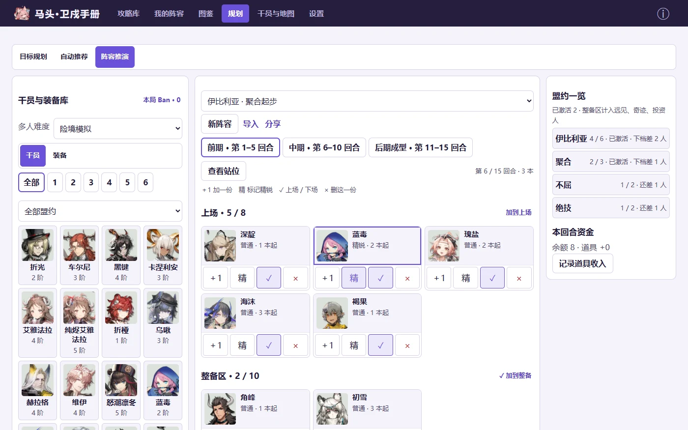
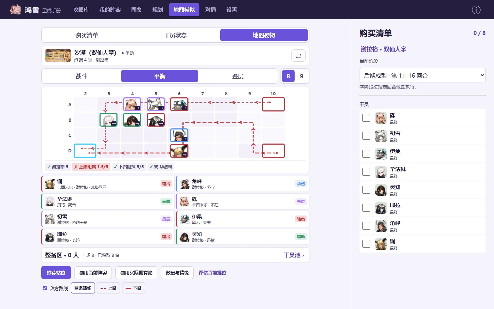
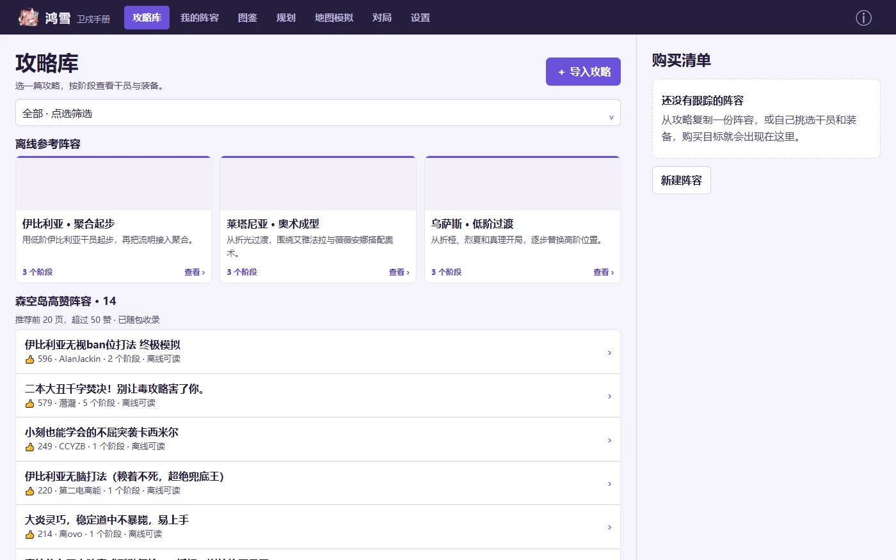
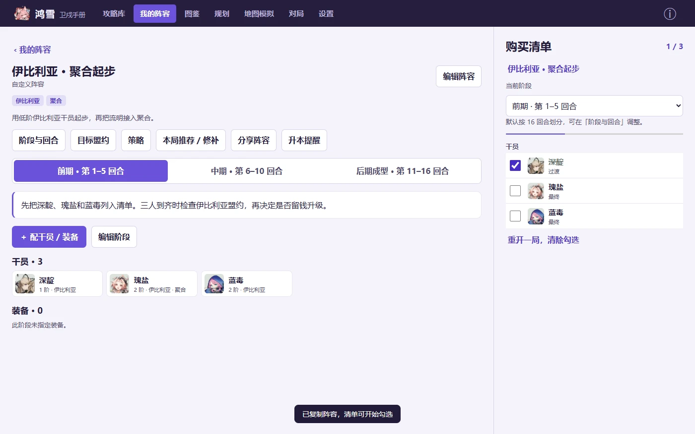
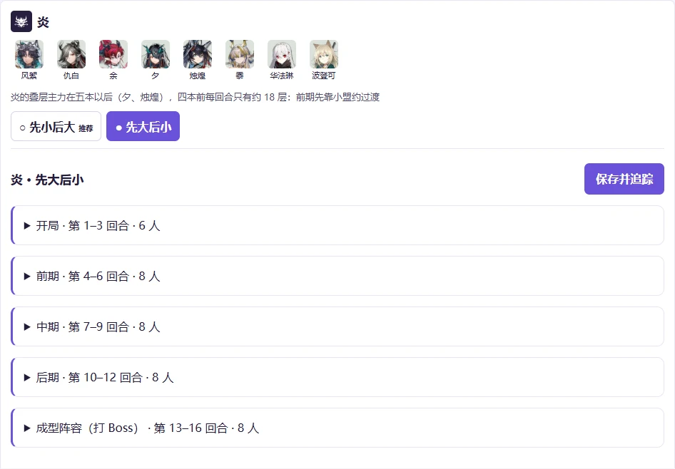

# 马头·卫戍手册　Android 平板移植版

鸿雪·卫戍助手（Hongxue Stronghold Companion）的 Android 平板移植版，面向三星 **Galaxy Tab S8+**。在手机上玩《明日方舟》，在平板上查攻略、规划阵容、勾购买清单和推演站位。横屏并排显示当前页面和清单，竖屏或分屏时可上下滚动。

**[下载已签名的 APK](https://github.com/Johnnylov/hongxue-stronghold-companion-android/releases/latest)**

上游原仓库描述

> 鸿雪·卫戍助手（Hongxue Stronghold Companion）— 明日方舟卫戍协议辅助，提供干员与装备筛选、阵容规划与追踪、攻略导入及本局信息识别。基于 Moonfair/ASP_Assistant 的独立衍生版本。

游戏数据、规划引擎和文字识别模型均随包提供。可以手动记录对局，也可以在同一局域网接收 iPhone 的游戏画面。

## v1.2.0　平板本机悬浮与购买识别

- 游戏装在平板上时，点顶部「游戏连接 → 本机游戏悬浮窗」，允许悬浮显示并确认 Android 的屏幕共享。支持选择单个应用的系统可只共享《明日方舟》。回到游戏后，拖动「马头」调整位置，轻点展开建议。「攻略」可在浮窗内翻手册，「结束」停止采集。
- 在开局确认页或局内「本局信息」面板稍作停留。手册会核对可见的禁用盟约、敌方领袖、多个特训敌人和画面上显示的模式。收起浮窗可减少对游戏文字的遮挡。未读清的项目保留原记录。
- 两种连接方式都能识别已购买的干员。先读到稳定的商店和余额，再看到该卡位连续两次变空且余额下降，才会加入持有池并按已有规则合成精锐。遇到遮挡、余额不可读或快速切屏导致漏记，可手动调整持有池。
- iPhone 视频收包与解码、文字识别分开运行；没有新画面和视频连接被重置分别提示。iPhone 与 Galaxy Tab S8+ 真机的长时间连接仍待实测。

## v1.1.0　iPhone 同屏识别（试用）

1. iPhone 和平板连接同一 Wi-Fi，在现版手册点「游戏连接 → 接收 iPhone 投屏」。在 iPhone 控制中心的「屏幕镜像」选择平板上显示的 Matou 名称，按提示输入配对码。
2. 回到游戏，打开横屏商店。平板本地识别回合、本数、余额、升本价和商品。两次连续读数一致后更新。v1.2.0 支持自动记录已购干员，识别条件不足时可点小窗里的「拿了某某 ＋1」补记。
3. 接收时可在手册内切页查攻略、收起和展开小窗。点「断开 iPhone」或将手册切到后台会停止接收。网络需允许两台设备互相访问和组播发现。

目前以 Android 模拟器和上游商店截图验证，iPhone 与 Galaxy Tab S8+ 的真实配对、不同画幅及商店皮肤仍需实机确认。投屏模块采用 android-airplay-server v0.0.36，协议、模型及依赖来源见 APK「许可与归属」。源码构建脚本按 SHA-256 校验依赖。

## v1.0.9 回合与行动建议

- 「干员与地图 → 下一步做什么」标题直接显示当前回合与终端。面板里的「下一回合」、上方快捷按钮及对局设置下拉框同步更新同一局，支持跳选和回退；第 15 回合停止前进。
- 改回合后立即显示本回合预算、道具收入、升级价格和资金差额，按当前本数与购买缺口刷新行动建议。实际余额优先，未记录时明确标注开局未消费估算。
- 有回合范围的跟踪攻略会提示本轮阶段和缺少的干员。终端等级仍由玩家记录，已有清单的自动切阶段设置继续生效。末回合显示成型目标和本级可买的补强人选。

## v1.0.8 地图站位模式

- 地图上把「推荐站位」移到「战斗 / 平衡 / 叠层」旁边。点模式后立即显示选中状态和计算进度，完成时显示实际模式和上场人数。如果人选、格子和朝向完全相同，会明确提示。
- 空棋盘有可用持有干员时用持有池。有跟踪清单时可用当前阶段试摆，实际持有和购买勾选保持独立。两者都为空时，「选干员并推荐站位」直接打开选人面板，点「应用整队」即计算。
- 「下一步做什么」的阶段阵容也可一键放到地图试摆。计算失败时棋盘保留错误原因和重试入口。切换模式途中退出后，重开可继续完成该次选择。

## v1.0.7 购买清单阶段选择

点右侧阵容名下的「购买清单阶段」，前、中、后期会在该栏正下方展开。点选后同步阵容与清单，点空白处或按返回可收起。

## v1.0.6 地图页的阶段阵容与下拉选择

- 地图、对局回合、终端、实际余额和升级价可直接用系统下拉框选择。购买清单、攻略详情、我的阵容和阵容推演都用下拉框选择阶段。
- 移除「采用 4」一类按钮。回合预计收入只作参考，当前余额按手机上的实际金额选择，0 与未记录分别保存。
- 「干员与地图 → 下一步做什么」直接显示桌面规划器的阶段阵容和运营建议。有持有记录时按本局干员匹配；跟踪普通攻略时，界面区分攻略购买清单与计算出的路线。已有自动路线继续沿用保存的阵容。
- 当前阶段列出干员头像、等阶、三连、新加入、盾位、奶位和叠层手。逐项显示优先购买理由、已持有和待补、升本条件，以及提前留哪张牌和哪个阶段用。一本显示升二本预算和二本开局预览，四本与五本分别显示对应的决策。[桌面原版阶段卡](https://github.com/bingyunhe/hongxue-stronghold-companion/blob/v1.9.4/src/ASPAssistant.Core/ViewModels/LineupPlannerViewModel.cs#L1032-L1091)

## v1.0.5 多人阵容推演与地图预览

- 自动推荐首屏展开当前本数的原版路线建议，含购买顺序及理由、速升或停留的条件、资金缺口和提前留牌。中期分别显示四本与五本，保存后的路线也会按最新持有和资金更新。[桌面原版阶段建议](https://github.com/bingyunhe/hongxue-stronghold-companion/blob/v1.9.4/src/ASPAssistant.Core/Services/AutoPlanner.cs#L225-L325)
- 平板干员卡可直接点「＋1」多拿一份，新增普通份进入整备区，达到条件自动合精锐。「精」切换该份精锐，「✓」上场或下场，「×」仅删除这一份。地图上连续修改份数无需反复计算整队站位。
- 放大「干员与地图」的当前地图预览。点图可看整张大图，点「看图选地图」可直接比较 10 张带名称的地图。
- 「规划 → 阵容推演」新增干员与装备库、分阶段的上场与整备区、盟约人数和下一档缺口。可在该阶段独立试摆，返回继续配队。多人难度和本局禁用与对局共用。
- 「自动推荐」按实际持有、精锐与对子、当前终端和余额推荐阵容。显示这回合遇到谁先拿、什么时候适合升本。再次导入同一路线沿用原清单和勾选进度。
- 多人标准模拟区分固定关闭和随机置灰，标准额外置灰 0 个核心、2 个附加，险境、绝境、终极各 5 个核心、5 个附加。按游戏实际置灰选择。[多人禁用实现](https://github.com/sganggs/Stronghold-Protocol/blob/55f528e9fc4872388360ee85e13eca8594856204/server/match/pool.js#L33-L60)
- 对局上限改为 15 回合，已有第 16 回合记录自动归入第 15 回合。余额可点选 0–20。新增盟约之币、两种玩偶、驮兽储蓄罐与定期存折的收入记录，区分即时、下回合和以后每回合，支持按实际到账校正。四种多人难度均有回合资金参考，第 4 回合起使用复刻估算。[资金实现](https://github.com/sganggs/Stronghold-Protocol/blob/55f528e9fc4872388360ee85e13eca8594856204/server/match/gamedata.js#L257-L267)

## v1.0.4 本回合建议

- 在「干员与地图」看「下一步做什么」。根据当前终端、持有人选和精锐对子，提示本级可补的人、还要升几本、升级还差多少资金。已保存的自动路线沿用桌面版当前终端的购买及升级建议。点选余额和确认实际购入仍由玩家决定。
- 在「规划」展开「各本怎么走」可看一至六本的通用建议。目标规划、自动推荐及阶段路线给每位干员标出普通商店从几本开始可刷；自选槽、策略赠送与三连机会单独注明。
- 禁用恢复 Windows v1.9.4 的核心优先逻辑。只禁「聚合」时，褐果被禁、瑰盐可用。薇薇安娜的两个核心「莱塔尼亚」和「卡西米尔」都置灰才会被禁。棋盘、图鉴和规划使用同一份原版规则；勾选时即时查看受影响名单。[v1.9.4 禁用源码](https://github.com/bingyunhe/hongxue-stronghold-companion/blob/v1.9.4/src/ASPAssistant.Core/Services/CovenantBanRules.cs)
- 在「干员与地图 → 对局设置 → 资金」可按模式查看各回合发放参考，点「采用」才把参考额记作当前余额。极速第 1–5 回合分别为 6、7、8、9、10，第 6–9 回合为 11。同一模式的两局中，第 9 回合分别实领 11 和 13，后一局的远见跨过了 10 层。[极速模拟实录](https://www.bilibili.com/video/BV1MyWn6TEBq/?t=803) · [远见奖励实录](https://www.bilibili.com/video/BV1dsWX6uEQy/?t=364)
- 规程等级 1 的 14 轮通关实录中，第 1–8 回合从 4 逐轮增加到 11，第 9–14 回合均为 11。入门协议单列客户端教学配置的 3、9、10、10。缺少实测的模式和回合会显示待核实。[规程等级 1 实录](https://www.bilibili.com/video/BV1fnWn6QEf9/?t=107) · [游戏配置](https://github.com/Kengxxiao/ArknightsGameData/blob/7e560050b03c34661db1d322d008733072352b2a/zh_CN/gamedata/excel/activity_table.json)

## v1.0.3 马头·卫戍手册

- 应用名称改为「马头·卫戍手册」。沿用原来的 Android 包名和签名，支持覆盖升级。
- 干员状态和地图合为「干员与地图」。棋子常显完整干员名、同名份数编号和朝向。点棋子可直接点选普通和精锐各几名，继续点另一枚棋子就能接着改。点「完成并推荐站位」后统一计算。
- 「快调干员」在同一面板支持选人、移除、调份数与精锐。点头像选中并调整，点卡片右侧的勾或加号可快速增减人选。点「应用整队」提交本轮修改。实际持有池、地图试摆与自定义阵容阶段均可用。地图默认使用实际持有池；选择「使用当前阵容」会进入独立试摆。
- 普通干员按 3 合 1 记录，普通数量可点 0、1、2，点「购入」会自动合成精锐。星极按特质 2 合 1。旧记录中超过阈值的普通份数在升级时折算。
- 在棋盘上方展开「对局设置」即可调整回合、终端、资金、升级价、禁用、领袖及特训敌人。资金可在同页直接点选 0–20，旧存档的超额余额会修正至 20。可额外手动禁用个别干员。盟约禁用判定已在 v1.0.4 对齐 Windows 原版。

### 本局推荐阵容

点购买清单旁的「推荐阵容」可以看到本局上场建议，并根据当前回合、持有数量和精锐状态匹配内置攻略、导入攻略及自己的阵容。卡片列出本阶段已有干员、缺少的干员和精锐缺口。候选会避开本局禁用干员与不可用的盟约组合。点「跟踪到购买清单」可切到对应阶段，已有干员自动勾选。

缺少匹配攻略时，使用原版阵容规划器围绕持有干员的盟约计算成型方案。也可以点「按持有干员另算一套」。若可部署干员超过地图模拟的 8/9 人位，使用原版站位算法从持有池挑选上场干员。在「干员与地图」点「跟踪到购买清单」，右侧直接显示还要买的干员，棋盘仍在当前页。

## v1.0.2 修复内容

- **特训敌人支持多选**。在「对局信息」直接勾选本局出现的类型，可同时查看每种类型前、后半程的候选敌人。单独取消一项会保留其他选择。升级或恢复旧版备份会保留原先选中的类型，开始新局会清空本局勾选。

## v1.0.1 修复内容

- **地图推荐站位**。预编译原版 C# 搜索引擎，在同一次搜索中复用路线覆盖和盟约计算。搜索显示第几轮，可以取消。切换模式、地图或干员池时取消旧计算，相同条件可直接恢复上次推荐。
- **装备图鉴**。70 件装备按 1–6 阶分组，可以直接点等阶，再叠加功能和转职筛选。卡片展示普通与精锐的完整数值和触发条件。24 件转职装备标明对应盟约，原版无精锐形态的装备标明「无精锐装备」。配置阶段需求和给干员选装备时也可按等阶勾选。

## 快速上手

1. 在平板的发布页下载 `Matou-Tablet-v1.2.0.apk`，点开安装。已安装上一版时可以直接覆盖升级，保留本机阵容与清单。如果系统提示，为打开 APK 的浏览器或文件管理器允许“安装未知应用”。
2. 在「攻略库」打开一份离线参考，也可以直接读取推荐的森空岛攻略，或粘贴一篇卫戍协议详情链接。导入的攻略保存在本机。
3. 点「复制为我的阵容」，选择当前阶段。在右侧清单勾选已购干员或装备。点「配干员 / 装备」调整需求，点干员可编辑精锐、标签和装备。阶段切换和应用重启均保留勾选。
4. 打开「干员与地图」并选图，点「使用当前阵容」或「使用实际拥有池」。点「推荐站位」算出位置与朝向，也可以先选一名干员再点格子摆位。选中已部署干员后可转向、下场或固定，固定的棋子会保留到下一次推荐。

## 功能

| 页面 | 平板上可以做什么 |
| --- | --- |
| 攻略库 | 随包包含 14 篇森空岛高赞阵容（34 个阶段），可搜索离线参考和已导入攻略，按回合查看攻略思路、候选干员、技能、模组与装备。在线攻略保留森空岛作者和原文入口。 |
| 图鉴 | 查询 218 名干员（含自选目录）、70 件装备、26 个盟约与 61 项策略。支持名称、拼音首字母、等阶、盟约、词条、触发时机、功能和转职筛选。 |
| 我的阵容 | 新建、复制、编辑、调整阶段顺序与回合范围，设置目标盟约、策略、核心装备和优先候选。按本局情况预览替补，另存或应用修补方案。可导入桌面阵容 JSON 与 dpaste 链接，也可在系统分享面板分享。 |
| 购买清单 | 按阶段或全程核对，合并多队需求和来源。实际拥有池按等阶、职业和盟约组合筛选，可连续点选多名干员后一次应用。勾选进度、实际拥有数量及精锐数保存在本机，可按手动录入的回合自动切换阶段。 |
| 规划 | 接入上游目标搜索、自动推荐及路线算法。按 8/9 人与各转职次数分组展示候选，每组最多三套。候选带干员头像，两种打法可单选并展开。可锁定干员、指定转职次数与特殊策略，查看先小后大或先大后小的五阶段方案，保存为阵容。 |
| 干员与地图 | 内置 10 张棋盘及 20 条有方向的敌方路线。用不同线宽的红色虚线和箭头标出上下路，可分别查看。棋盘下实时校验盟约人数、各路线阻挡与治疗，干员卡显示输出、承伤、辅助或叠层职责。支持手动部署、换位、朝向、固定、同名多份与精锐。可按战斗、均衡或叠层偏好推荐并评估站位。 |
| 干员与地图 → 对局设置 | 点选第 1–15 回合与终端等级，按模式、等级和升级回合计算基础升级价，可校正实际余额及折扣，录入禁用盟约及干员，查看 10 位敌方领袖的分难度血量、隐藏形态与 9 类特训敌人资料。 |
| 设置 | 默认使用原版可露希尔浅色主题，支持原版三套深浅主题、界面缩放、自选干员、多队追踪、本机数据备份与恢复、GitHub 发布页。 |

## 内置攻略快照

2026-11-19 读取森空岛规程赛季默认「推荐」前 20 页，每页 10 篇，共 200 个不同攻略 ID。按点赞字段（不含收藏数）严格筛选大于 50，随包收录 14 套、34 个阶段。快照保留作者、原文链接、采集时点赞数、干员、装备与技能模组。作者的运营讲解可在联网时从原文读取并保存。推荐顺序和点赞会随时间变化。

内置三阶段参考默认分为前期第 1–5 回合、中期第 6–10 回合、后期成型第 11–15 回合。自定义阵容可编辑区间。常规操作全部点选，数量与精锐通过数字按钮选择，外部文本支持按需粘贴或系统文件导入。森空岛阵容优先使用原攻略的回合范围，仅有成型页时显示「成型目标 · 无固定回合」。

## 适配与验证

- 目标设备为三星 Galaxy Tab S8+。最低系统版本为 Android 8.0，需要较新的 Android System WebView。
- 实际安装验证使用 MuMu 的 Android 12L / API 32，测试了横屏、覆盖安装、冷启动恢复、在线攻略导入和离线站位推荐。Galaxy Tab S8+ 实机及三星系统特有行为仍待验证。
- 浏览器界面回归覆盖地图固定与换位、目标规划、五阶段自动推荐、阵容修补、JSON 导出再导入、本局禁用、暗色和窄屏布局。路线测试逐格比对 10 张地图两路的拐点、箭头数量、出入口与单路显示。
- 本版聚焦平板独立使用。游戏画面捕获/OCR、模拟器连接、游戏内覆盖层、Windows 托盘和全局快捷键属于桌面端集成。平板版的站位展示、操作与进度都在应用内完成。
- 推荐沿用原版默认搜索参数（每轮 5,000 次迭代、5 次重启、固定种子 1）。地图直接展示阻挡与治疗校验，仅手动改摆后对照推荐方案显示分差。清除应用数据或卸载会移除本机记录，可提前在设置中导出备份。

## 从源码构建

需要 Python 3.10+、JDK 17、.NET 8 SDK、Android SDK Platform 35 与 Build Tools 35.0.0。设置 `JAVA_HOME` 与 `ANDROID_HOME`，确保 `dotnet` 在 PATH 中，或用 `DOTNET_EXE` 指向 .NET 8 的可执行文件。首次构建请运行 `dotnet workload install wasm-tools` 安装 WebAssembly 预编译工具，并确保可访问 NuGet。仓库已包含运行所需的游戏数据与图片。

1. 使用 `keytool -genkeypair -keystore tablet.jks -alias hongxue -keyalg RSA -keysize 3072 -validity 10000` 创建个人签名，密钥和密钥库使用同一个密码。
2. 在当前终端把密码存入 `HX_STORE_PASS` 环境变量。
3. 执行 `python scripts/build.py --keystore tablet.jks`。脚本先将 C# 算法编译成 WebAssembly，再打包、对齐、签名并校验 APK。产物位于 `build/Matou-Tablet-v1.2.0.apk`，自行构建的签名与发布版不同。

游戏数据取自固定的上游提交。更新资料时，安装 Pillow 后执行 `python scripts/prepare_data.py <上游仓库目录>`。安装 Python Playwright 和 Chromium 后可运行 `python tests/check_routes.py` 验证全部敌方路线，也可以用 `CHROME_PATH` 指向已安装的 Chrome。

## 来源与许可

基于 [bingyunhe/hongxue-stronghold-companion 的 15c074d](https://github.com/bingyunhe/hongxue-stronghold-companion/tree/15c074d227f7ca9aecbdfdf84e4ac79a0c8f0a6a) 与 [Moonfair/ASP_Assistant](https://github.com/Moonfair/ASP_Assistant)。感谢 Moonfair、bingyunhe、Jiayu Ding（CarlosDJY）及其他上游贡献者。算法源文件位于 `engine/upstream`，Android 界面与桥接代码由本移植版新增。

代码遵循 Apache License 2.0，保留上游的 [LICENSE](LICENSE)、[LICENSE.upstream](LICENSE.upstream) 和 [NOTICE](NOTICE)。游戏数据、名称、美术及攻略内容归各自权利人所有。本项目与鹰角网络、森空岛及上游作者无官方隶属关系。

经济数据来自[规程序列 I 客户端配置](https://github.com/Kengxxiao/ArknightsGameData/blob/7e560050b03c34661db1d322d008733072352b2a/zh_CN/gamedata/excel/activity_table.json)，调度中心逐回合降价规则见 [PRTS 操作说明](https://prts.wiki/w/卫戍协议/帮助)。规程等级 1、7 及险境模拟原版首回合测试画面显示余额 4。它是画面观测值。入门协议有逐回合基础发放表，常规对局的实时余额由用户按本局操作校正。

在安装包生成后，可运行 `python tests/check_desktop_parity.py`。该测试从 APK 解出实际随包运行的引擎，与 Windows v1.9.4 发布包 `HongxueCompanion.Core.dll` 计算的两组参考结果比对，每组连续运行五次，校验每名干员的坐标、朝向、校验条与总分。另以覆盖全部 10 张地图的 Windows 参考结果核对精锐、同名多份、固定位置、整备区、详细说明和分项得分，并测试重复推荐与连续切换模式。Windows 基准运行器位于 `tests/DesktopParity`。
